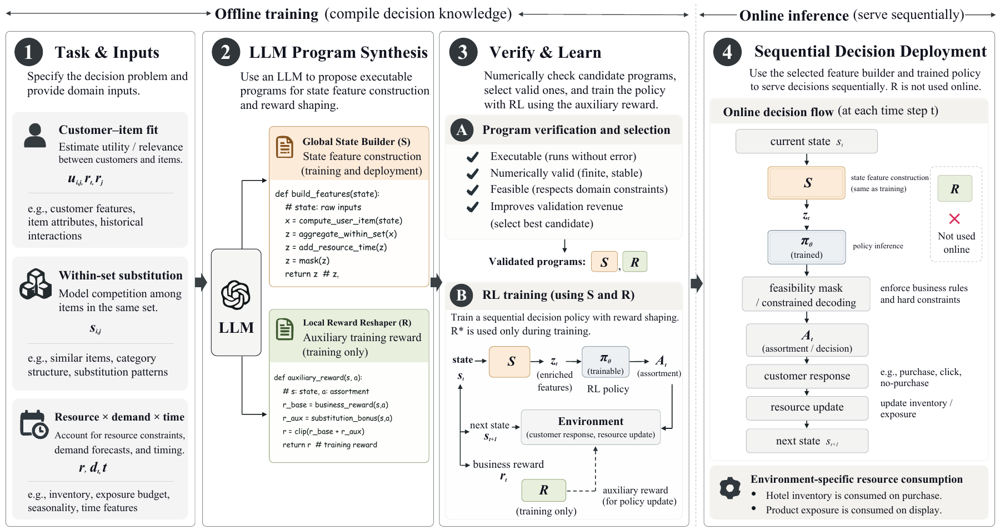

<h1 align="center">Large Language Models for Dynamic Assortment</h1>
<p align="center"><strong>A Knowledge-Guided Learning Approach</strong></p>
<p align="center">
  <a href="#overview">Overview</a> ·
  <a href="#quick-start">Quick start</a> ·
  <a href="EXHIBITS.md">Tables and figures</a> ·
  <a href="experiment/README.md">Experiment code</a>
</p>

## Overview

Dynamic assortment policies spend scarce resources across successive customer requests. Expedia hotel inventory is consumed on booking. KuaiSearch exposure capacity is consumed on display. In both settings, a decision changes the resources available to serve later requests.

<details open>
<summary><strong>Background · Two resource environments</strong></summary>
<br>
<p align="center"></p>
</details>

The framework uses an LLM during offline development to propose executable programs. The **Global State Builder (S)** enriches the policy input with relationships among demand, remaining resources, and available candidates. The **Local Reward Reshaper (R)** provides auxiliary feedback during training. At inference, the trained policy uses S and a feasibility mask to select the assortment.

<details open>
<summary><strong>Method · Program design, learning, and deployment</strong></summary>
<br>
<p align="center"></p>
</details>

## Quick start

Python 3.10 or newer. The released aggregate tables and plots can be reproduced on a CPU.

```bash
git clone https://github.com/1-fang/dynamic-assortment.git
cd dynamic-assortment
python -m pip install -r requirements.txt
python scripts/render_tables.py
python scripts/check_figure_data.py
python scripts/plot_updated_results.py
python scripts/draw_planning_figures.py
python scripts/plot_deployment.py
```

The commands write Markdown tables and figures to `out/`. To inspect one exhibit, run `python scripts/render_tables.py --table 3`. The [exhibit index](EXHIBITS.md) links each manuscript table and figure to its input and script.

| Directory | Contents |
| --- | --- |
| [`assets/`](assets/) | Background and method illustrations |
| [`data/`](data/) | Manuscript aggregate statistics and table cells in JSON |
| [`scripts/`](scripts/) | Table rendering, plot checks, and figure generation |
| [`experiment/`](experiment/) | Selected implementation modules and a CPU example |

The release includes aggregate data for eight main tables and sixteen appendix tables, plus the S/R parameter guide. It includes selected implementation code for feasible assortment selection, A2C updates, customer-response evaluation, and resource accounting. Fig. 3 includes a plotting script with a documented input format. Its epoch-level inputs are outside the current release.

The [MIT License](LICENSE) applies to the released software and its documentation. The figure assets and result summaries accompany this research artifact. Access to the underlying platform interaction datasets follows their respective provider terms.
