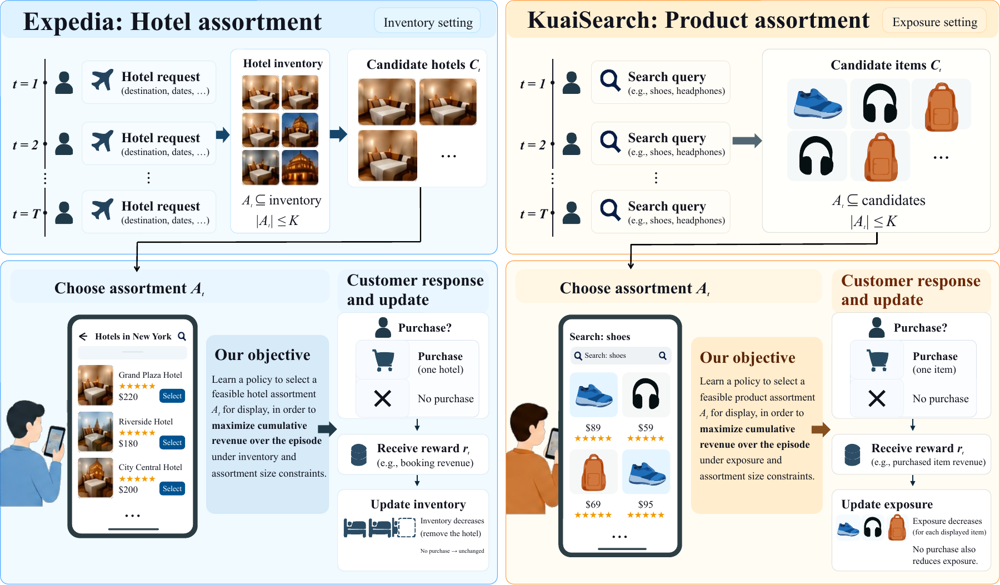

<h1 align="center">Compiling Operational Knowledge for Dynamic Assortment</h1>

<strong>LLM-Guided Policy Learning under Resource Constraints</strong>

  <a href="#overview">Overview</a> ·
  <a href="#data">Data</a> ·
  <a href="results/README.md">Tables and figures</a> ·
  <a href="reproduce_results.ipynb">Reproduce results</a> ·
  <a href="experiment/README.md">Experiment code</a>

## Overview

Dynamic assortment policies spend scarce resources across successive customer requests. Expedia hotel inventory is consumed on booking. KuaiSearch exposure capacity is consumed on display. In both settings, a decision changes the resources available to serve later requests.

<strong>Background · Two resource environments</strong>

 

The framework uses an LLM during offline development to propose executable programs. The **Global State Builder (S)** enriches the policy input with relationships among demand, remaining resources, and available candidates. The **Local Reward Reshaper (R)** provides auxiliary feedback during training. At inference, the trained policy uses S and a feasibility mask to select the assortment.

<strong>Method · Program design, learning, and deployment</strong>

 

## Data

The experiments cover nine settings built from Expedia and KuaiSearch-Lite. The data guide lists the dataset sources, train, validation and test counts, market and query tiers, and the revenue metrics. [Read the data guide](data/README.md)

| Directory | Contents |
| --- | --- |
| [`assets/`](assets/) | Background and method illustrations |
| [`results/`](results/) | CSVs indexed by manuscript table and figure |
| [`data/`](data/) | Data sources, evaluation splits, and earlier aggregate JSON files |
| [`scripts/`](scripts/) | Table rendering and figure generation |
| [`experiment/`](experiment/) | Selected implementation modules and a CPU example |

The [results index](results/README.md) follows the current RQ1–RQ3 manuscript. The [reproduction notebook](reproduce_results.ipynb) reads the CSVs and displays the tables and figures. The implementation covers feasible assortment selection, A2C updates, customer-response evaluation, and resource accounting.

The [MIT License](LICENSE) applies to the released software and its documentation. The figure assets and result summaries accompany this research artifact. Access to the underlying platform interaction datasets follows their respective provider terms.
